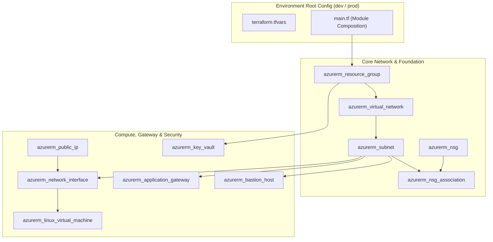

# Azure Generic Terraform Modules

[](https://www.terraform.io/)
[](https://registry.terraform.io/providers/hashicorp/azurerm/latest)
[](https://github.com/sanjiivsingh/terraform-azure-resource-modules/actions/workflows/CI.yaml)
[](https://github.com/sanjiivsingh/terraform-azure-resource-modules)
[](https://opensource.org/licenses/MIT)

A curated collection of 11 reusable, modular Terraform child modules for provisioning enterprise Azure cloud infrastructure following Infrastructure as Code (IaC) standards and clean separation of concerns. Detailed verification logs are provided in [docs/EVIDENCE.md](docs/EVIDENCE.md) and architectural standards in [docs/ARCHITECTURE.md](docs/ARCHITECTURE.md).

---

## Architecture Overview



---

## Features

- **Atomic Child Modules**: 11 decoupled, single-responsibility modules.
- **Environment-Specific Composition**: Ready-to-deploy examples for `dev` and `prod`.
- **Strict Naming & Tagging Conventions**: Uniform resource naming across Azure regions.
- **Dynamic Blocks**: Conditional and optional configuration blocks for flexible resource configurations.
- **Landing Zone Friendly**: Direct drop-in modules for enterprise hub-spoke topologies.
- **Static Validation & Linting**: Validated with `terraform fmt`, `terraform validate`, and `tflint`.

---

## Repository Structure

```
.
├── modules/
│   ├── azurerm_application_gateway/
│   ├── azurerm_bastion_host/
│   ├── azurerm_key_vault/
│   ├── azurerm_linux_virtual_machine/
│   ├── azurerm_network_interface/
│   ├── azurerm_nsg/
│   ├── azurerm_nsg_association/
│   ├── azurerm_public_ip/
│   ├── azurerm_resource_group/
│   ├── azurerm_subnet/
│   └── azurerm_virtual_network/
│
└── environments/
    ├── dev/
    └── prod/
```

---

## Available Modules

| Module | Description | Inputs |
|--------|-------------|--------|
| `azurerm_resource_group` | Creates Azure Resource Groups with governance tags | `name`, `location`, `tags` |
| `azurerm_virtual_network` | Provisions VNets with configurable CIDR address spaces | `name`, `address_space`, `location`, `resource_group_name` |
| `azurerm_subnet` | Creates Subnets with optional service endpoints | `name`, `resource_group_name`, `virtual_network_name`, `address_prefixes` |
| `azurerm_public_ip` | Provisions Standard SKU Public IP addresses | `name`, `resource_group_name`, `location`, `allocation_method`, `sku` |
| `azurerm_network_interface` | Configures Network Interfaces (NIC) with IP configs | `name`, `resource_group_name`, `location`, `ip_configuration` |
| `azurerm_nsg` | Creates Network Security Groups with security rules | `name`, `resource_group_name`, `location`, `security_rules` |
| `azurerm_nsg_association` | Associates NSGs with target subnets or NICs | `subnet_id` / `network_interface_id`, `network_security_group_id` |
| `azurerm_linux_virtual_machine` | Provisions Ubuntu/RHEL VMs with SSH key auth | `name`, `resource_group_name`, `location`, `size`, `admin_username` |
| `azurerm_bastion_host` | Secure remote management Bastion host | `name`, `resource_group_name`, `location`, `ip_configuration` |
| `azurerm_key_vault` | Secure secrets & key management vault | `name`, `resource_group_name`, `location`, `sku_name`, `tenant_id` |
| `azurerm_application_gateway` | Layer-7 load balancing & SSL termination | `name`, `resource_group_name`, `location`, `sku`, `gateway_ip_configuration` |

---

## Prerequisites

- **Terraform** >= 1.9.0
- **Azure CLI** >= 2.60.0
- **Azure Subscription** with Contributor or Owner rights

---

## Getting Started

### 1. Clone the repository

```bash
git clone https://github.com/sanjiivsingh/terraform-azure-resource-modules.git
cd terraform-azure-resource-modules
```

### 2. Authenticate to Azure

```bash
az login
az account set --subscription "<SUBSCRIPTION_ID>"
```

### 3. Initialize and Validate an Environment

```bash
cd environments/dev
terraform init
terraform validate
```

### 4. Run Terraform Plan

```bash
terraform plan
```

---

## Example Module Usage

```hcl
module "resource_group" {
  source = "../../modules/azurerm_resource_group"

  name     = "rg-platform-dev"
  location = "eastus2"

  tags = {
    Environment = "Development"
    ManagedBy   = "Terraform"
    Project     = "CloudFoundation"
  }
}
```

---

## Contributing

1. Fork the repository.
2. Create a feature branch (`git checkout -b feature/new-module`).
3. Validate code formatting (`terraform fmt -check`).
4. Commit your changes following Conventional Commits.
5. Push to the branch and open a Pull Request.

---

## License

This project is licensed under the [MIT License](LICENSE).

---

## Author

**Sanjeev Singh**  
Senior Azure Cloud Architect & DevSecOps Platform Engineer  
[GitHub Profile](https://github.com/sanjiivsingh) | [Website](https://sanjeevsingh.oneps.in) | [LinkedIn](https://linkedin.com/in/sanjiivsingh)
